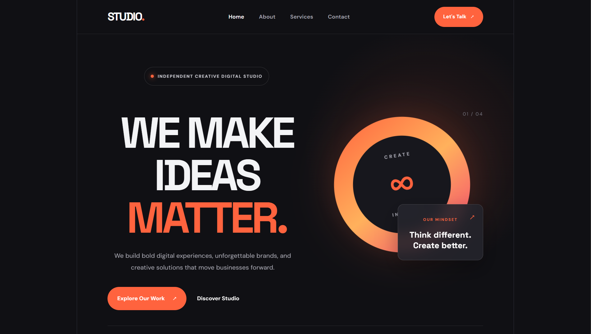
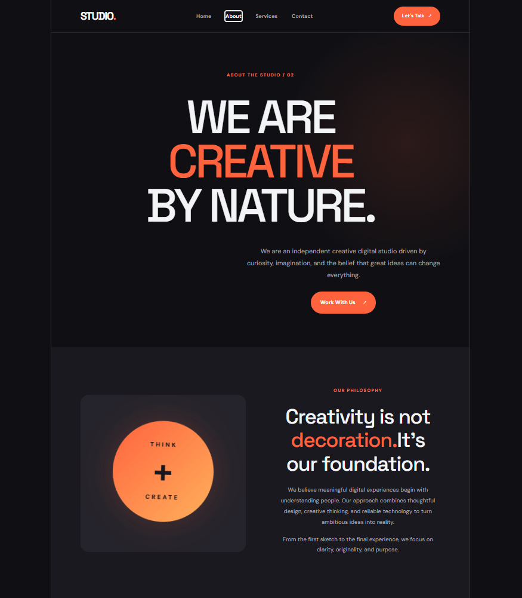
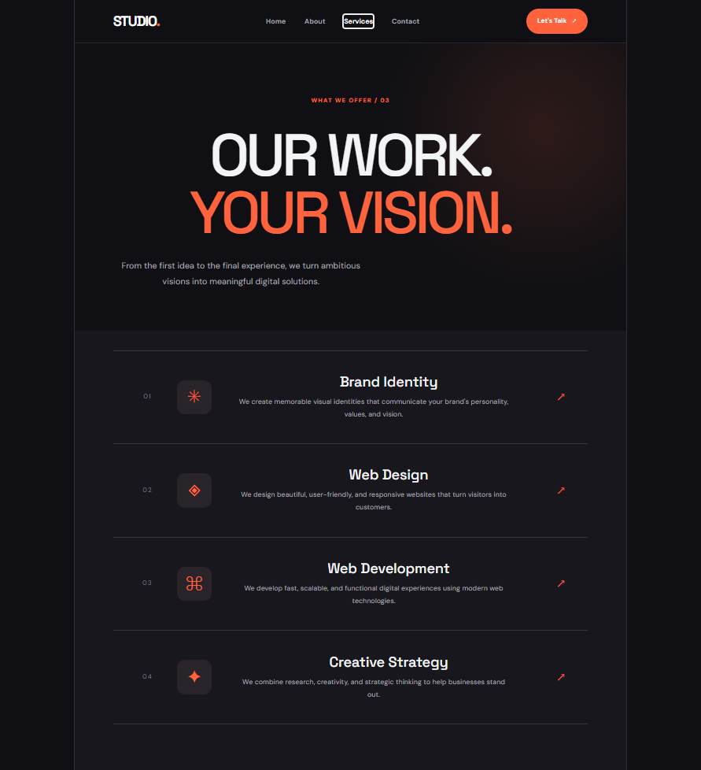
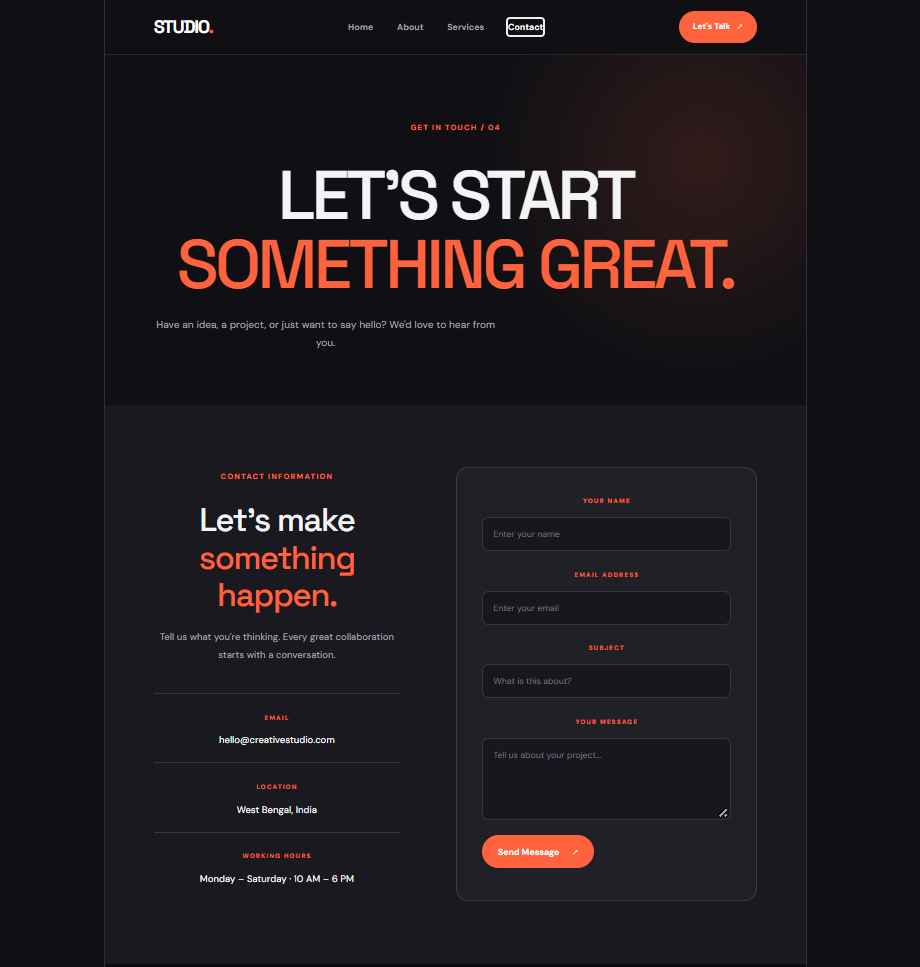

# STUDIO. — Creative Digital Agency Website

A modern, responsive, multi-page creative studio website built with React and Vite as part of the **Synent Technologies Web Development Internship — Task 7**.

## Screenshots

### Home Page


### About Page


### Services Page


### Contact Page


## Features

- Four separate pages: Home, About, Services, and Contact.
- Navigation between pages using React Router DOM.
- Modern dark-themed creative studio design.
- Reusable Navbar and Footer components.
- Contact form with required-field and email-format validation.
- Frontend success message after form submission.
- Responsive layout and mobile navigation.

## Technology Stack

- React 19
- Vite
- JavaScript (ES6+)
- HTML5
- CSS3
- React Router DOM
- ESLint

## Project Structure

```text
src/
├── assets/
│   └── hero.png
├── components/
│   ├── Navbar.jsx
│   └── Footer.jsx
├── pages/
│   ├── Home.jsx
│   ├── About.jsx
│   ├── Services.jsx
│   └── Contact.jsx
├── App.jsx
├── App.css
├── index.css
└── main.jsx

screenshots/
├── 01-homepage.png
├── 02-about.png
├── 03-services.png
└── 04-contact.png
```

## Installation and Setup

### Prerequisites

- Node.js
- npm
- Git

### 1. Clone the repository

```bash
git clone https://github.com/Arghya-03/synent-task7-multipage-website-arghya-maji.git
```

### 2. Navigate to the project folder

```bash
cd synent-task7-multipage-website-arghya-maji
```

### 3. Install dependencies

```bash
npm install
```

### 4. Start the development server

```bash
npm run dev
```

Open the local URL displayed in your terminal.

## Production Build

```bash
npm run build
```

## Code Quality Check

```bash
npm run lint
```

## Contact Form Note

The contact form currently demonstrates frontend functionality, including required-field validation, email-format validation, and a success message.

It does not currently send emails or store submitted messages in a backend or database.

## Demo Video

Task 7 demonstration video will be added here after publishing on LinkedIn.

## Internship Information

**Organization:** Synent Technologies  
**Internship:** Web Development Internship  
**Task:** Task 7 — Multi-Page Website

## Author

**Arghya Maji**

GitHub: https://github.com/Arghya-03

## Project Status

- Four website pages implemented.
- Page navigation tested.
- Contact form validation tested.
- Dummy form submission tested.
- Production build: Passed.
- ESLint: Passed.

---

Built with creativity and React.
